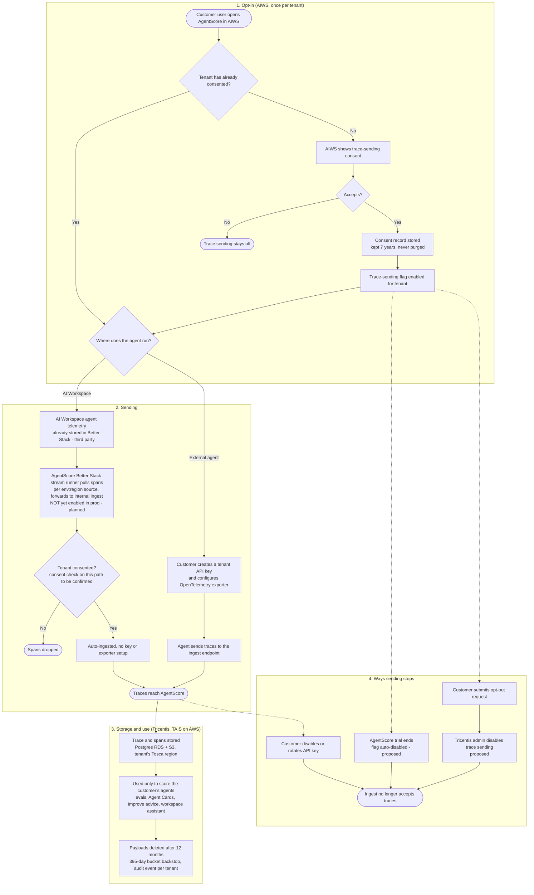

# AgentScore Trace Sending: User Flow

Companion to [agentscore-trace-legal.md](agentscore-trace-legal.md). Covers how a tenant opts in to trace sending in AIWS, how traces get sent, and how sending stops.

## Flow

## Notes

- **Consent scope:** once per tenant. When admins are introduced, an admin can accept on behalf of the tenant, or individual users can accept.
- **Consent vs sending:** consent turns the capability on. For agents in AI Workspace, traces then flow automatically. For external agents, traces only flow when the customer's agent sends them with a tenant API key (the legal doc's "separate act").
- **Legal doc mismatch:** `agentscore-trace-legal.md` describes only the API-key path ("Who opts in") and says there is "no third-party trace vendor" ("Where it runs"). Once the Better Stack stream is enabled in prod, both need updating for AI Workspace users: sending is no longer a separate act, and Better Stack becomes a third party holding their traces.
- **No self-serve opt-out** is planned. The two proposed off-ramps are trial-end auto-disable and a request-based disable by a Tricentis admin (steps S2 to S4).
- **Not in this flow (gaps from the legal doc):** customers cannot delete traces themselves, there is no DSAR job, and there is no automatic PII redaction or flagging.

## Open questions

- What does the ingest endpoint do if a key is valid but the tenant has not consented (reject, or accept silently)? The legal doc does not say, so the diagram assumes the flag gates ingest.
- Does disabling the flag also stop ingest immediately, or only on the next key check?
- **Consent on the Better Stack path:** the stream runner reads by `env:region` source and service name, not by tenant. Where are non-consented tenants' spans filtered out? The diagram shows a consent check, but I have not found one in the code for this path.
- The "API key disabled" off-ramp does not apply to AI Workspace traces, so the consent flag would be the only control.
- **Better Stack as a third party:** AI Workspace spans sit in Better Stack before AgentScore pulls them. Its retention and region for those spans are not documented in the repo, and a tenant purge in AgentScore would not delete them there.
- Is enabling the stream in prod the intended long-term mechanism? The architecture notes call it an "interim supply line", and it is off by default behind a default-deny environment allow-list.
