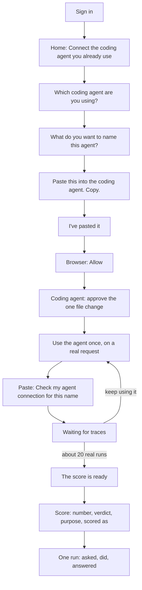
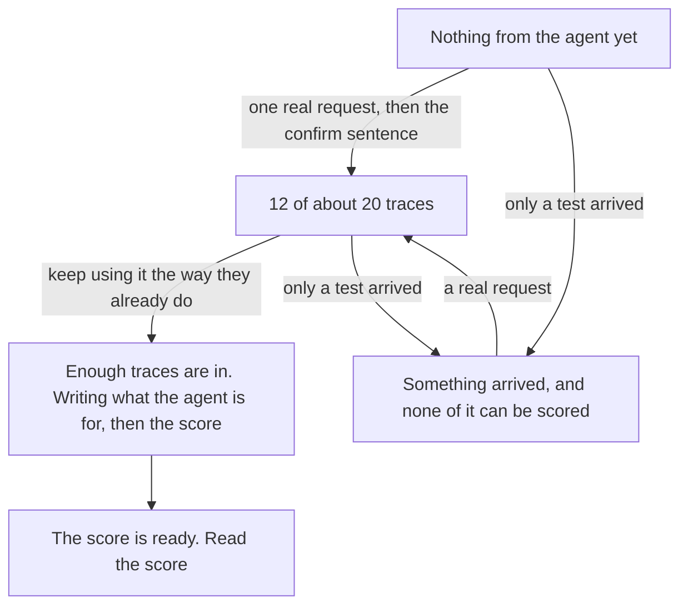

# First session: jobs and workflow

5 November 2026. Draft.

Screens are the [first-session mock](first-session-product-mock.html). Step copy, failure lines, and product gaps are in [First-session onboarding](2026-11-04-first-session-onboarding.md).

The person already runs an agent. They have that project open in Cursor, Claude Code, Codex, or the Claude apps. They decide whether the agent can ship. They do not know traces, evals, profiles, or instrumentation, and this session does not teach those words.

## The job

When I have an agent that already runs, and I am the one who decides whether it can ship, I want a score and a verdict from the work it already does, so I can make that call without setting up tracing, picking what to measure, or writing an eval.

Four jobs get them there. The session ends on the fourth, after they read the verdict and open one number.

| Job | When | I want to | So I can |
| --- | --- | --- | --- |
| 1. Connect the agent I already have | I am signed in, and the project is already open in my coding agent | Copy one paste that carries the name I chose and the address | Hand the connection to the coding agent. I do not pick a trace format, a profile, or a key |
| 2. Prove it on a real request | The coding agent has written the connection | Use the agent the way I already do, then hear that this named agent is sending work | Keep a ping or a hello from becoming the score |
| 3. Leave while the score is written | One real run is not enough for a verdict | See how close the score is, and that I can leave | Keep using the agent, and come back when a verdict exists |
| 4. Read the call and the run behind it | A score exists | See one number, one verdict, what the agent is for, and the run behind any part of the score | Decide whether it ships |

Job 3 is the waiting page. It is not an extra action. Jobs 1, 2, and 4 are the ten actions below.

## Workflow

Three actors. The person moves. Agent Score shows one next action. The coding agent stores the address, writes the secret, and answers the confirm sentence. The agent they already run is what produces the traces.

| # | Where | The person | Agent Score | The coding agent |
| --- | --- | --- | --- | --- |
| 1 | Sign-in, then Home | Signs in with a Tosca Cloud account | Home has one line and Connect. No tour, no example agents | |
| 2 | Connect window | Picks the coding agent that has the project open | | |
| 3 | Connect window | Names the agent they already run. The name is the one on the score | | |
| 4 | Connect window | Copies the paste | Puts that name and that client into the block. The address is inside the paste | |
| 5 | The project already open | Pastes the block | | Stores the address |
| 6 | The browser the card opens | Clicks Allow | Signs the coding agent in as them | |
| 7 | The coding agent's own approval | Approves the one change: Connect `<agent name>` to Agent Score | Waiting for traces is already open, from I've pasted it | Writes the secret into the project environment file. Does not print it. Does not ask what to measure |
| 8 | The agent they already run | Restarts it if it was running, then sends one real request | The waiting page says a test does not count | |
| 9 | The same thread | Pastes the confirm sentence, with the same name | | Replies in one line: the agent is connected, activity is coming in, the score appears after about 20 real runs, they can leave |
| 10 | My Agents, then Score | Opens the agent and reads the verdict. Opens one number | Lands on Score. Shows the score, the verdict, the purpose, and the fitted profile. The number opens that run: what was asked, what it did, what it answered | |

Actions 2, 3, and 4 are one window. Action 7 is the coding agent's approval, counted because the person has to give it. Action 10 is the end of the session.

## While they wait

Waiting for traces stays up from I've pasted it until a score exists. The heading changes only when the score is ready. They can leave the page open.

| Page | What they are told | Next action |
| --- | --- | --- |
| Nothing yet | Nothing from this agent yet. Use it the way you already do. A score needs about 20 traces. A test does not count. | Use it once for real, then paste the confirm sentence |
| 12 of about 20 | Keep using it the way you already do. A test does not count. You can leave this page open. | Keep using it. Leave if they want |
| Writing the score | Agent Score is writing what this agent is for, then the score. You can leave this page open. | Leave and come back to this agent |
| Can't be scored | Something arrived, and none of it can be scored. A test does not count. | Use it on a real request, then paste the confirm sentence again |
| The score is ready | The score, and the verdict. Ship with note in the mock. | Read the score |

My Agents shows the same moments on the row. The waiting page is the one they are sent to from the connect window. Opening the agent before a score exists shows the same sentence on the Score tab, with no Score now button.

## When the path stops

Each stop already has one next action. The lines are in section 4 of the onboarding note.

| Stop | Where they see it | Next action |
| --- | --- | --- |
| Not signed in | Sign-in, or the browser step never opens | Sign in with the Tosca Cloud account |
| Coding agent is not connected | The connect window | Copy the address, paste it whole, click Allow |
| Confirm finds nothing for that name | The coding agent's reply | Use the agent on a real request, then paste the confirm sentence again |
| Activity arrived and none of it can be scored | Waiting for traces | Same as the row above |
| Score still being written | Waiting for traces | Close the page and come back to this agent |
| Score ready | Score | Read the verdict and open one number |

## Where the session ends

The Score tab. In the mock that is 82, Ship with note, a purpose written from the agent's real runs, and Scored as Tool Caller. Opening a number shows one run: asked, did, answered.

They do not open Agent Card, Profile, Improve, Settings, Traces, or Labeling on this visit. Those tabs stay in the product. Custom evals, profile editing, simulation, and the improvement loop stay out of this session.
