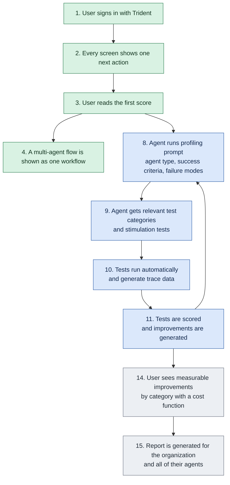

**AgentScore Roadmap - Beta Onboarding and Self-Improvement**

Date: 11-04-2026. Status: draft.

| Now | Next | Later |
|---|---|---|
| Improved onboarding | Stimulation testing | Trace data protection |
| Tricentis identity | App usability | AIWS integration |
| Workflow management | JEV / decision model | Quantitative cost function |
| Internal Tricentis agents | Session grouping | Tenant-wide agent reporting |

**Target persona:** a semi-technical user who can create agents but does not know how to configure traces, instrumentation, or agent updates. This user creates or evaluates agents and makes the final call before an agent ships.

**North star:** get as many users, including internal users, as possible using AgentScore regularly. The product must prove its value: users must actually use it and benefit from it. Onboarding should be so straightforward that the next action is never in question, and the user reaches a score they can act on as quickly as possible.

## Target user flow

Steps 1 to 4 are Now. Steps 8 to 11 (stimulation testing) are Next, and they repeat until the score meets the ship bar. Steps 14 and 15 are Later. Internal coverage of Tricentis agents is Now and is not a numbered step. App usability, the JEV / decision model, and session grouping are Next and are not numbered steps. Steps 12 and 13, the previous self-improvement loop, are marked done and are not on this diagram. Step numbers on steps 8 to 11 and 14 to 15 are unchanged.

Green is Now. Blue is Next. Grey is Later.

# Now

## Improved onboarding

**What it is:** the first session, from sign-in to a first score, where every screen has one next action. Flow steps 2 and 3. The feature list that used to sit under Simplify onboarding is marked done. This theme is the remaining bar.

**Why it matters:** the target persona can create agents and does not know how to configure traces or instrumentation. A screen with several ways forward loses them before the first score. Self-service onboarding is a High recurring ask from Wolters Kluwer and L'Oreal. Labs graduation criterion 1 is real active use (5 tenants with manual runs and return usage across 2 or more weeks), which depends on people reaching a score quickly. Gaps are still open in the product: Home does not open the connect card, the first score does not start on its own, and verdict names differ by screen. Marking the old feature list done does not close those gaps.

**What we hope to accomplish:** a user always knows the single next action, and reaches one score and one verdict for an agent they already run, without choosing profiles, evals, or instrumentation.

**North star tie:** this is the direct path to the north star. Beta reach depends on it, and the Labs Ignite to Activate bar starts with real active users.

### Features and epics

- **Guided first session** (steps 2, 3). From the moment after sign-in, each screen offers one next action until the user reads a score and a verdict. They are not asked to configure traces, pick a profile, or write an eval on this path.

## Tricentis identity

**What it is:** sign-in through Tricentis identity (Trident). Flow step 1. This replaces Tosca Cloud sign-in.

**Why it matters:** sign-in is the front door of the first session. Merito still has an open question on whether a Tosca Cloud tenant is required for auth. Replacing that sign-in with Trident makes the account a user already has the way in. **Dispute risk:** tenant login-or-create, joining an existing tenant, and AI Workspace tenant reconciliation shipped under the old sign-in. This theme does not reopen that work. It swaps the identity provider.

**What we hope to accomplish:** a user signs in with Trident and lands in AgentScore with one obvious next action.

**North star tie:** a familiar Tricentis login removes one reason a new user stops before the first score.

### Features and epics

- **Trident sign-in** (step 1). Tricentis identity replaces Tosca Cloud sign-in. *(Replaces the shipped Tosca Cloud sign-in feature.)*

## Workflow management

**What it is:** a multi-agent flow is shown as one workflow. Flow step 4.

**Why it matters:** evaluating a group or hierarchy of agents, not one agent in isolation, is a High ask from Meta, Wolters Kluwer, Aptiv, Eaton, and Accenture. Aptiv asked to store and score a multi-agent workflow as a whole. Accenture marked multi-agent workflow testing as priority 1 (handoffs, shared state, approvals, and the final business action). This theme is the showing and grouping. Scoring or testing the workflow is a wider ask, called out under Open questions. **Dispute risk:** session grouping, which rolls one agent's traces into a task, stays Next. It is a different cut.

**What we hope to accomplish:** a user who runs several agents together sees that flow as one workflow.

**North star tie:** accounts that will not adopt a per-agent list get a view that matches how their agents actually run, which is what makes a second session likely.

### Features and epics

- **Workflow-level grouping** (step 4). Multi-agent flows are grouped and shown as one workflow.

## Internal Tricentis agents

**What it is:** every internal Tricentis agent is scored in AgentScore. This is an adoption outcome. It should not require AgentScore product work.

**Why it matters:** the north star is regular use, including by internal users. A full internal footprint is the proof that AgentScore is the place Tricentis scores its own agents. It is on Now because it matters now and it does not wait on a product change. The connection path those agents use is the guided first session, which is separate work.

**What we hope to accomplish:** internal Tricentis agents are connected and scoring, without a new AgentScore feature to get there.

**North star tie:** this is the internal half of the north star, measured as agents actually scored.

### Features and epics

- **Score every internal Tricentis agent.** Rollout and adoption. No AgentScore product work is expected.

# Next

## Stimulation testing

**What it is:** AgentScore profiles an agent, runs targeted tests against it, and scores the results, so a user can test an agent without waiting for organic traces. Flow steps 8 to 11. Moved from Now on 11-04 so the first session can reach a score on real use first.

**Why it matters:** scenario bank and simulation testing is the top High ask across Meta (x2), L'Oreal, Tritusa, Eaton, PG&E, and Accenture, and it is the pivotal gap for the Meta POC. Compliance validation with PII flagging (Tritusa, High) supports the compliance and PII test categories. **Dispute risk:** that demand would support Now. It is Next because the current bet is the guided first session, Trident, and workflow grouping.

**What we hope to accomplish:** an agent is profiled, given the test categories that fit it, tested automatically, and scored, with improvements generated from the results.

**North star tie:** it gives users a way to test before ship, which is the unmet ask that decides whether a prospect sees AgentScore as a complete testing step.

### Features and epics

- **Agent profiling prompt** (step 8). The user's agent runs a prompt that tells AgentScore what kind of agent it is, its success criteria, and its common failure modes.
  - Jira: story [AI-15844](https://tricentis.atlassian.net/browse/AI-15844) (Backlog).
- **Category-based stimulation test selection** (step 9). The agent is given the relevant test categories and stimulation tests that fit what it should do: compliance, security and PII, safety and harm, functional, usability, bias, robustness, multi-agent, MCP, and cost and efficiency.
  - Jira: stories [AI-15851](https://tricentis.atlassian.net/browse/AI-15851) (Backlog), [AI-15852](https://tricentis.atlassian.net/browse/AI-15852) (Backlog), [AI-15853](https://tricentis.atlassian.net/browse/AI-15853) (Backlog), [AI-15854](https://tricentis.atlassian.net/browse/AI-15854) (Backlog), [AI-15855](https://tricentis.atlassian.net/browse/AI-15855) (Backlog).
- **Automated stimulation test runs** (step 10). The selected tests run automatically and generate trace data in AgentScore.
  - Jira: stories [AI-15845](https://tricentis.atlassian.net/browse/AI-15845) (Backlog), [AI-15846](https://tricentis.atlassian.net/browse/AI-15846) (Backlog), [AI-15847](https://tricentis.atlassian.net/browse/AI-15847) (Backlog), [AI-15848](https://tricentis.atlassian.net/browse/AI-15848) (Backlog), [AI-15849](https://tricentis.atlassian.net/browse/AI-15849) (Backlog), [AI-15850](https://tricentis.atlassian.net/browse/AI-15850) (Backlog).
- **Stimulation scoring and improvement generation** (step 11). The test results are scored and improvements are generated.
  - Jira: stories [AI-15856](https://tricentis.atlassian.net/browse/AI-15856) (Backlog), [AI-15857](https://tricentis.atlassian.net/browse/AI-15857) (Backlog).

## App usability

**What it is:** product polish that makes AgentScore legible while a user waits and when they read results.

**Why it matters:** the Now persona is semi-technical. Long-running actions with no feedback, and technical dimension and eval names, make results hard to trust. These do not block the guided first session, so they stay Next. **Dispute risk:** a waiting page and one verdict vocabulary are part of reaching the first score. If those are required for step 3, they belong on Now, inside Improved onboarding.

**What we hope to accomplish:** users always see that an action is progressing, and understand every dimension and eval in plain language.

**North star tie:** supports return use once someone has a score.

### Features and epics

- **Progress bars for all actions.** Every long-running action shows progress.
  - Jira: stories [AI-15178](https://tricentis.atlassian.net/browse/AI-15178) (Backlog), [AI-15179](https://tricentis.atlassian.net/browse/AI-15179) (Backlog), [AI-15180](https://tricentis.atlassian.net/browse/AI-15180) (Backlog), [AI-15181](https://tricentis.atlassian.net/browse/AI-15181) (Backlog), [AI-15870](https://tricentis.atlassian.net/browse/AI-15870) (Backlog).
- **Plain-language descriptions of dimensions and evals.** Every dimension and eval gets a non-technical explanation.
  - Jira: story [AI-15268](https://tricentis.atlassian.net/browse/AI-15268) (Backlog). [AI-11884](https://tricentis.atlassian.net/browse/AI-11884) (Done) covered plain-language evaluations in the scoring UI.

## JEV / decision model

**What it is:** a hybrid scorer. JEV runs where it applies. The fuller judge runs where it does not. The point is less scoring time and less scoring cost.

**Why it matters:** scoring cost and latency cap how often a user can run, and how many agents a tenant can keep on a score. A cheaper model on the cases it can decide keeps the fuller judge for the cases that need it. Galileo's decision-model metrics (2026-10-27) are the competitive version of this bet: classify and score text faster and cheaper than LLM-as-a-judge. **Dispute risk:** the expansion of JEV is unconfirmed. See Open questions.

**What we hope to accomplish:** each eval uses the cheaper model when that model is fit for the check, and the judge when it is not, with no drop in the verdict a user would act on.

**North star tie:** cheaper, faster scoring is what makes regular use affordable once more than a handful of agents are connected.

### Features and epics

- **Hybrid JEV and judge.** Use JEV where it applies, and the current judge where it does not, to save scoring time and cost.

## Session grouping

**What it is:** related traces from one agent are grouped into a task or conversation, and the score covers that whole session. The per-agent scorecard is marked done and is no longer in this theme.

**Why it matters:** a score on one trace misses a multi-step task. The August 24 working session called session-based scoring one of the two highest-priority product gaps, beside dynamic scoring profiles. **Dispute risk:** workflow-level grouping is Now and is a different cut (several agents in one flow). This stays Next unless you want it pulled into Now with workflow management.

**What we hope to accomplish:** a user can score a whole task or conversation, not only a single trace.

**North star tie:** the score matches the unit of work the user cares about, which is what makes the verdict worth acting on.

### Features and epics

- **Session grouping.** Related traces are grouped into a task or conversation, and the score covers that whole session.
  - Jira: epic [AI-15832](https://tricentis.atlassian.net/browse/AI-15832) (Backlog).

# Later

## Trace data protection

**What it is:** keeping sensitive information out of stored traces.

**Why it matters:** Tritusa raised compliance and PII flagging on traces as a High blocker for regulated (bank and pharma) clients. Wolters Kluwer raised data handling concerns in a governance-driven context, and Eaton asked for a written answer on data handling.

**What we hope to accomplish:** regulated users can send traces without exposing PII or other sensitive data.

**North star tie:** widens the set of users who can adopt AgentScore. None of the asks was a blocker for the first beta cohort, so this is Later. **Dispute risk:** if regulated beta accounts need this before onboarding, it moves up.

### Features and epics

- **PII and sensitive-data redaction from traces.** Sensitive information is redacted from traces. Treated as separate from AIWS integration.
  - Jira: story [AI-11914](https://tricentis.atlassian.net/browse/AI-11914) (Backlog).

## AIWS integration

**What it is:** show AgentScore results on agents inside AI Workspace, so a user sees how an agent scores without leaving AIWS. The score and ship decision come from the AgentScore score endpoint: `/v1/tenants/{slug}/agents/{name}/score`.

**Why it matters:** L'Oreal already has AI Workspace and 1M+ agent credits but could not ingest into AgentScore without the Workspace admin team configuring it first. AI Workspace is the easiest surface for reaching AgentScore (AI-11881), and showing the score in place is the visible payoff.

**What we hope to accomplish:** once an AIWS agent is scored, its score and ship decision appear next to it, the user is told when new evidence makes a rescore worthwhile, and later can see scoring status and score movement.

**North star tie:** a built-in route to users who already have AI Workspace. The score shows in the tool they already use. It stays in Later because it is marked optional for beta, and the owner of the AI Workspace UI has not yet been engaged.

### Features and epics

- **Score and ship decision next to the AIWS agent.** Once an AIWS agent is scored, show its score and `ship_decision`, read from `/v1/tenants/{slug}/agents/{name}/score`.
  - Jira: story [AI-11912](https://tricentis.atlassian.net/browse/AI-11912) (Backlog). Confirm it includes `ship_decision`.
- **"New evidence available. Rescore?" prompt.** A link or button that appears when new traces have arrived since the last score. Open question: a minimum number of new traces before it shows, so a single extra trace does not trigger a rescore.
  - Jira: none found.
- **Later: scoring status.** Show whether a score is running. Open question: can this be done when all AgentScore endpoints are GETs?
  - Jira: none found.
- **Later: score change indicator.** An arrow showing how the score moved since the last run.
  - Jira: none found.

**Existing AI-11881 stories not in this list:** AI-12669 (ingest EUS3 production traces so workspace-created agents appear in AgentScore), AI-12670 (AgentScore as a built-in AIWS agent type with visible trace routing), AI-11911 (choose agents and workflows to score from AIWS), AI-11910 (improve onboarding for AIWS agents). Decide whether to keep them in the theme, or defer or drop them. AI-15142 (reconcile AIWS auto-created tenants) was counted under the old sign-in work, which is now marked done.

## Quantitative cost function

**What it is:** the user sees measurable improvements by category, each with a cost impact, backed by a quantitative model that puts a measured dollar or risk value on each improvement. Flow step 14.

**Why it matters:** showing impact such as "saves $X in token spend" proves the value of each improvement. A quantitative model makes those numbers defensible for the person who makes the final ship call.

**What we hope to accomplish:** every improvement carries a calculated cost or risk value the user can trust and compare.

**North star tie:** shows beta users the benefit of AgentScore in numbers, which supports the proof-of-value half of the north star.

### Features and epics

- **Measurable improvements by category** (step 14). The user sees improvements by category, each with a cost impact, for example "saves $X in token spend" or "avoided a GDPR violation here."
  - Jira: epic [AI-15833](https://tricentis.atlassian.net/browse/AI-15833) (Backlog). AI-11896 tracks credits per scoring run, which is Tricentis billing, not this value.
- **Quantitative cost function for improvements.** Each generated improvement is valued with a quantitative cost model, for example token spend saved or risk exposure avoided.
  - Jira: epic [AI-15833](https://tricentis.atlassian.net/browse/AI-15833) (Backlog).

## Tenant-wide agent reporting

**What it is:** generate a report for the organization covering all agents in a tenant. Flow step 15.

**Why it matters:** the person who decides what ships needs one view across every agent, not one report per agent.

**What we hope to accomplish:** a user generates a single report for all agents in their tenant.

**North star tie:** gives decision makers a reason to keep using AgentScore after the first agent is scored.

### Features and epics

- **Report generation for all agents in a tenant** (step 15). One report covering every agent in the tenant.
  - Jira: epic [AI-15834](https://tricentis.atlassian.net/browse/AI-15834) (Backlog).

# Changes since last roadmap

Since the previous version:

- **Marked done:** every feature under Simplify onboarding (Tosca Cloud sign-in, automatic tenant provisioning, join existing tenants, unified agent view, Getting Started guide, zero-config MCP connection, automatic profile and eval selection). Per-agent scorecard. The self-improvement loop (improvement feedback to the agent, and the re-score and iterate loop).
- **Added:** Improved onboarding (one next action through the first score). Tricentis identity (Trident), which replaces Tosca Cloud sign-in. Workflow management (workflow-level grouping for multi-agent flows). Internal Tricentis agents (every internal agent scored; no AgentScore product work expected). JEV / decision model (hybrid, to save scoring time and cost).
- **Moved:** Stimulation testing from Now to Next.
- **Stayed:** App usability on Next. Session grouping on Next. The four Later themes are unchanged: trace data protection, AIWS integration, quantitative cost function, tenant-wide agent reporting.
- **Dropped:** none. Done items left the active horizons. They are not deleted from the product story.

# Open questions

- What does JEV expand to? This draft treats it as a cheaper decision model used beside the current judge.
- Does workflow-level grouping include scoring or testing the workflow as a whole (Aptiv, Accenture), or only showing the group?
- Should the waiting page and the single verdict vocabulary move into Now, under Improved onboarding, instead of staying in App usability?
- Does stimulation testing (steps 8 to 11) score with the shipped per-agent scorecard?
