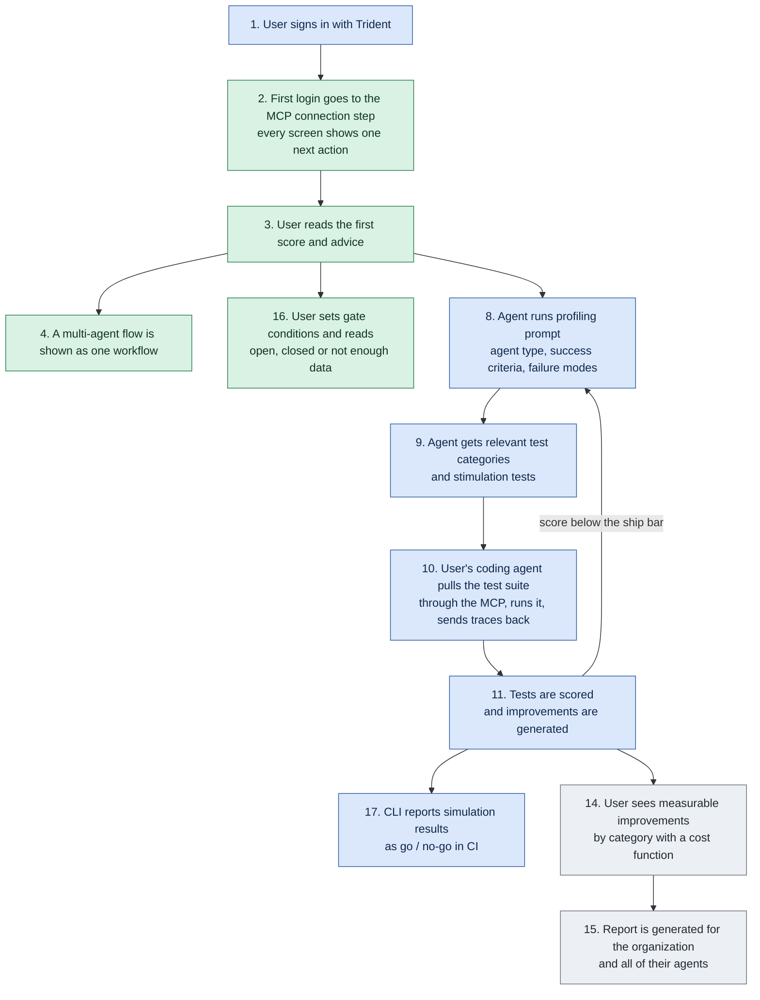

**AgentScore Roadmap - Beta Onboarding, Quality Gate and Self-Improvement**

Date: 11-11-2026. Status: draft. Jira alignment: [2026-11-11-agentscore-beta-roadmap-jira.md](../jira-alignment/2026-11-11-agentscore-beta-roadmap-jira.md).

| Now | Next | Later |
|---|---|---|
| Improved onboarding | Stimulation testing | Trace data protection |
| Quality gate | App usability | AIWS integration |
| Workflow management | JEV / decision model | Quantitative cost function |
| Internal Tricentis agents | Session grouping | Tenant-wide agent reporting |
|  | Tricentis identity |  |

**Target persona:** a semi-technical user who can create agents but does not know how to configure traces, instrumentation, or agent updates. This user creates or evaluates agents and makes the final call before an agent ships.

**North star:** get as many users, including internal users, as possible using AgentScore regularly. The product must prove its value: users must actually use it and benefit from it. Onboarding should be so straightforward that the next action is never in question, and the user reaches a score they can act on as quickly as possible.

## Target user flow

Steps 2 to 4 and step 16 (quality gate) are Now. Step 1 (Trident sign-in), steps 8 to 11 (stimulation testing) and step 17 (CI go / no-go) are Next. Steps 8 to 11 repeat until the score meets the ship bar. Steps 14 and 15 are Later. Internal coverage of Tricentis agents is Now and is not a numbered step. App usability, the JEV / decision model, and session grouping are Next and are not numbered steps. Steps 12 and 13, the previous self-improvement loop, are marked done and are not on this diagram. Step numbers on steps 1 to 4, 8 to 11 and 14 to 15 are unchanged. Steps 16 and 17 are new on 11-11.

Green is Now. Blue is Next. Grey is Later.

# Now

## Improved onboarding

**What it is:** the first session, from sign-in to a first score, where every screen has one next action. Flow steps 2 and 3. The feature list that used to sit under Simplify onboarding is marked done. This theme is the remaining bar. On 11-11 the flow was made concrete: a first login with no data goes straight to the MCP connection step, a waiting screen holds until the user authenticates, and the user is guided in the coding agent's thread through to the first score and advice.

**Why it matters:** the target persona can create agents and does not know how to configure traces or instrumentation. A screen with several ways forward loses them before the first score. Self-service onboarding is a High recurring ask from Wolters Kluwer and L'Oreal. Labs graduation criterion 1 is real active use (5 tenants with manual runs and return usage across 2 or more weeks), which depends on people reaching a score quickly. Gaps are still open in the product: Home does not open the connect card, the first score does not start on its own, and verdict names differ by screen. The 11-11 sync agreed that the HTML mock (`docs/planning/features/onboarding/first-session-product-mock.html`) is the base for the engineer's spec.

**What we hope to accomplish:** a user always knows the single next action, and reaches one score and one verdict for an agent they already run, without choosing profiles, evals, or instrumentation.

**North star tie:** this is the direct path to the north star. Beta reach depends on it, and the Labs Ignite to Activate bar starts with real active users.

### Features and epics

- **Guided first session** (steps 2, 3). From the moment after sign-in, each screen offers one next action until the user reads a score, a verdict and advice. First login with no data opens the MCP connection step, a waiting screen holds until MCP auth completes, then an in-progress state and a "we're scoring, now you can ask the agent" step follow in the coding agent. The user is not asked to configure traces, pick a profile, or write an eval on this path.
  - Jira: stories [AI-17229](https://tricentis.atlassian.net/browse/AI-17229) (To Do), [AI-17230](https://tricentis.atlassian.net/browse/AI-17230) (To Do), [AI-16010](https://tricentis.atlassian.net/browse/AI-16010) (To Do), [AI-16011](https://tricentis.atlassian.net/browse/AI-16011) (To Do), all under epic [AI-15150](https://tricentis.atlassian.net/browse/AI-15150) (Backlog). One verdict vocabulary across screens has no story.

## Quality gate

**What it is:** each agent gets one quality gate (open, closed, or not enough data) computed from conditions the customer chooses over their scored traces. Traces that fail a per-trace condition are flagged. It is a signal only: it does not block deploys or stop the agent, and it does not change the verdict. Flow step 16. New on 11-11, from the approved product brief in AI-17189.

**Why it matters:** the verdict comes from a weighted average, so one trace that leaks personal data barely moves it and an agent can read "ship" while failing the one check the customer cares about most. Internally, Georgie Zaguirre asked for a security gate (Internal Feedback Log, High) after ATA read 88% ready to ship while completing a task correctly about 40% of the time. Tritusa asked for safety findings and company-specific guardrails on 11-10 (compliance validation row, High, Tritusa x2), which the privacy, security and safety templates answer. The CI/CD quality gate row (High, Eaton and Accenture) is the strongest customer demand for a pass/fail signal. The brief is approved and coding starts after the product owner's review (2026-11-11 sync). **Dispute risk:** v1 is signal-only and the brief rules out a key-authenticated CI API and native CI integrations, so Eaton's and Accenture's "block the release in CI" is not met by this theme. Georgie's "cannot be marked ready to ship" is also not met: the gate stays separate from the verdict, as the brief decides. Both are recorded under Open questions.

**What we hope to accomplish:** a user can say "this must never fail" about a check that matters to them, and get a clear open or closed answer that names the failing condition and links to the traces behind it.

**North star tie:** it turns a score into a ship decision the user can act on, and gives integrations (MCP clients, AI Workspace) a plain pass/fail to read.

### Features and epics

- **Gate conditions and gate state** (step 16). Three condition kinds: share of flagged traces (with "any single trace" as a preset), a floor on one eval, dimension or the overall score, and a drop from the previous revision. Each condition has a population and a minimum evidence level. The gate reads closed, not enough data (with a reason), open, or no gate configured. *(Merges the internal Security gate ask: a security floor or the security template covers it.)*
  - Jira: story [AI-17189](https://tricentis.atlassian.net/browse/AI-17189) (To Do).
- **Flags on traces, with acknowledge and override.** A flagged trace shows the condition, the eval score and the judge's reason, and trace lists can filter to flagged traces. A person can acknowledge one flag as a false alarm, or override a closed gate, with a required reason.
  - Jira: story [AI-17189](https://tricentis.atlassian.net/browse/AI-17189) (To Do).
- **Tenant-level conditions and ready-made templates.** Back office sets mandatory tenant-level conditions. Tricentis ships privacy, security and safety templates built on existing evals. Conditions are authored in a form or drafted by the chat assistant behind the approval card.
  - Jira: story [AI-17189](https://tricentis.atlassian.net/browse/AI-17189) (To Do).
- **Gate history and read surfaces.** Every state change, condition change, acknowledgement and override is recorded with the evidence. The gate is shown in the customer app and back office, and readable through the customer app API, MCP, and the AI Workspace internal read API (no free text there). Includes starting a new revision from the customer app, which the drop condition needs.
  - Jira: story [AI-17189](https://tricentis.atlassian.net/browse/AI-17189) (To Do).

## Workflow management

**What it is:** a multi-agent flow is shown as one workflow. Flow step 4.

**Why it matters:** evaluating a group or hierarchy of agents, not one agent in isolation, is a High ask from Meta, Wolters Kluwer, Aptiv, Eaton, and Accenture. Aptiv asked to store and score a multi-agent workflow as a whole. Accenture marked multi-agent workflow testing as priority 1 (handoffs, shared state, approvals, and the final business action). This theme is the showing and grouping. Scoring or testing the workflow is a wider ask, called out under Open questions. **Dispute risk:** session grouping, which rolls one agent's traces into a task, stays Next. It is a different cut.

**What we hope to accomplish:** a user who runs several agents together sees that flow as one workflow.

**North star tie:** accounts that will not adopt a per-agent list get a view that matches how their agents actually run, which is what makes a second session likely.

### Features and epics

- **Workflow-level grouping** (step 4). Multi-agent flows are grouped and shown as one workflow.
  - Jira: none found.

## Internal Tricentis agents

**What it is:** every internal Tricentis agent is scored in AgentScore. This is an adoption outcome. It should not require AgentScore product work.

**Why it matters:** the north star is regular use, including by internal users. A full internal footprint is the proof that AgentScore is the place Tricentis scores its own agents. It is on Now because it matters now and it does not wait on a product change. The connection path those agents use is the guided first session, which is separate work.

**What we hope to accomplish:** internal Tricentis agents are connected and scoring, without a new AgentScore feature to get there.

**North star tie:** this is the internal half of the north star, measured as agents actually scored.

### Features and epics

- **Score every internal Tricentis agent.** Rollout and adoption. No AgentScore product work is expected.
  - Jira: tasks [AI-16547](https://tricentis.atlassian.net/browse/AI-16547) (Done), [AI-16564](https://tricentis.atlassian.net/browse/AI-16564) (Done), [AI-16563](https://tricentis.atlassian.net/browse/AI-16563) (To Do), no epic.

# Next

## Stimulation testing

**What it is:** AgentScore profiles an agent, generates targeted tests for it, has them run, and scores the results, so a user can test an agent without waiting for organic traces. Flow steps 8 to 11 and 17. The 11-11 sync settled how the tests run: AgentScore generates a test suite from the agent's existing traces and evals (for example, the PII eval drives adversarial tests), exposes it through the MCP, and the user's coding agent pulls it, decides how to run it, injects it, and sends the traces back for scoring. Tests and their results are stored per agent and linked, so the user re-runs them like unit tests. A CLI, which wraps the MCP, is the optional happy path and reports the simulation results as a go / no-go for CI. The MCP-only route still works.

**Why it matters:** scenario bank and simulation testing is the top High ask across Meta (x2), L'Oreal, Tritusa, Eaton, PG&E, and Accenture, and it is the pivotal gap for the Meta POC. On 11-10 Tritusa, the only actively-using account, asked for safety findings. The 11-11 sync noted that organic traces cannot show an agent will never leak PII or break GDPR, so the agent has to be prompted with test inputs. Compliance validation with PII flagging (Tritusa x2, High) supports the compliance and PII test categories. The CLI answers part of the CI/CD quality gate row (Eaton, Accenture). The sync named the differentiator as the knowledge base (common failure modes by agent type, what to test, why, and how to read results), not the mechanics of generating tests. **Dispute risk:** that demand would support Now. It is Next because the current bet is the guided first session and the quality gate. The CLI reports simulation results only for now, not the quality gate state, so CI users get a go / no-go on simulation runs, not on production traces.

**What we hope to accomplish:** an agent is profiled, given the test categories that fit it, tested by the user's own coding agent, and scored, with improvements generated from the results and a go / no-go a pipeline can read.

**North star tie:** it gives users a way to test before ship, which is the unmet ask that decides whether a prospect sees AgentScore as a complete testing step.

### Features and epics

- **Agent profiling prompt** (step 8). The user's agent runs a prompt that tells AgentScore what kind of agent it is, its success criteria, and its common failure modes.
  - Jira: story [AI-15844](https://tricentis.atlassian.net/browse/AI-15844) (Backlog).
- **Category-based stimulation test selection** (step 9). The agent is given the relevant test categories and stimulation tests that fit what it should do: compliance, security and PII, safety and harm, functional, usability, bias, robustness, multi-agent, MCP, and cost and efficiency. Tests are generated from the agent's existing traces and evals.
  - Jira: stories [AI-15851](https://tricentis.atlassian.net/browse/AI-15851) (Backlog), [AI-15852](https://tricentis.atlassian.net/browse/AI-15852) (Backlog), [AI-15853](https://tricentis.atlassian.net/browse/AI-15853) (Backlog), [AI-15854](https://tricentis.atlassian.net/browse/AI-15854) (Backlog), [AI-15855](https://tricentis.atlassian.net/browse/AI-15855) (Backlog).
- **Test suite through the MCP, run by the user's coding agent** (step 10). AgentScore exposes the test suite through the MCP. The user's coding agent pulls it, runs it, and sends the traces back. Tests and results are stored per agent and linked. *(Replaces "tests run automatically": the 11-11 sync decided the coding agent runs them.)*
  - Jira: stories [AI-15845](https://tricentis.atlassian.net/browse/AI-15845) (Backlog), [AI-15846](https://tricentis.atlassian.net/browse/AI-15846) (Backlog), [AI-15847](https://tricentis.atlassian.net/browse/AI-15847) (Backlog), [AI-15848](https://tricentis.atlassian.net/browse/AI-15848) (Backlog), [AI-15849](https://tricentis.atlassian.net/browse/AI-15849) (Backlog), [AI-15850](https://tricentis.atlassian.net/browse/AI-15850) (Backlog).
- **Stimulation scoring and improvement generation** (step 11). The test results are scored and improvements are generated.
  - Jira: stories [AI-15856](https://tricentis.atlassian.net/browse/AI-15856) (Backlog), [AI-15857](https://tricentis.atlassian.net/browse/AI-15857) (Backlog).
- **Safety gate on simulation results** (steps 9, 11). A simulation run carries its own pass / fail on the safety findings it produced. Separate from the quality gate, which reads scored production traces. Feeds the Tritusa safety-findings request.
  - Jira: stories [AI-15853](https://tricentis.atlassian.net/browse/AI-15853) (Backlog, gates library), [AI-15856](https://tricentis.atlassian.net/browse/AI-15856) (Backlog, gate enforcement and run report).
- **CI go / no-go through a CLI** (step 17). A CLI that wraps the MCP runs the simulation tests and returns go / no-go from the simulation results only. It is the optional happy path; the MCP-only route keeps working, less polished.
  - Jira: story [AI-15850](https://tricentis.atlassian.net/browse/AI-15850) (Backlog).

## App usability

**What it is:** product polish that makes AgentScore legible while a user waits and when they read results.

**Why it matters:** the Now persona is semi-technical. Long-running actions with no feedback, and technical dimension and eval names, make results hard to trust. Plain-language explanations of traces, evals and failures are a High internal ask (Georgie Zaguirre and the 2026-11-04 ground-truth session): Georgie asked for a short failure summary in the UI and said the detail is already there if you look for it. Tritusa's 11-10 call made the same point from outside: the improvement advice on a 63.4 score was not readable enough to act on. These do not block the guided first session, so they stay Next. **Dispute risk:** the plain-language failure summary is rated High internally, and the guided first session now ends on "score and advice" (AI-17229). If the advice has to be readable for step 3, the failure summary belongs on Now, inside Improved onboarding.

**What we hope to accomplish:** users always see that an action is progressing, understand every dimension and eval in plain language, and can read in one line why a trace or eval failed.

**North star tie:** supports return use once someone has a score.

### Features and epics

- **Progress bars for all actions.** Every long-running action shows progress.
  - Jira: stories [AI-15178](https://tricentis.atlassian.net/browse/AI-15178) (Backlog), [AI-15179](https://tricentis.atlassian.net/browse/AI-15179) (Backlog), [AI-15180](https://tricentis.atlassian.net/browse/AI-15180) (Backlog), [AI-15181](https://tricentis.atlassian.net/browse/AI-15181) (Backlog), [AI-15870](https://tricentis.atlassian.net/browse/AI-15870) (Backlog).
- **Plain-language descriptions of dimensions and evals.** Every dimension and eval gets a non-technical explanation.
  - Jira: story [AI-15268](https://tricentis.atlassian.net/browse/AI-15268) (Backlog). [AI-11884](https://tricentis.atlassian.net/browse/AI-11884) (Done) covered plain-language evaluations in the scoring UI.
- **Plain-language failure summary.** A short, plain-language summary of why a trace or eval failed and the root cause, shown in the UI. The shape Georgie pasted: pass or fail, metric, score, judge type, and a one-line reason. The 2026-11-04 session calls judge plain language a prompt-level fix already in the backlog. *(New on 11-11, from the Internal Feedback Log High row.)*
  - Jira: none found. [AI-15177](https://tricentis.atlassian.net/browse/AI-15177) (Backlog) covers plain-language error messages, not eval failures.

## JEV / decision model

**What it is:** a hybrid scorer. JEV runs where it applies. The fuller judge runs where it does not. The point is less scoring time and less scoring cost.

**Why it matters:** scoring cost and latency cap how often a user can run, and how many agents a tenant can keep on a score. A cheaper model on the cases it can decide keeps the fuller judge for the cases that need it. Galileo's decision-model metrics (2026-10-27) are the competitive version of this bet: classify and score text faster and cheaper than LLM-as-a-judge. **Dispute risk:** the expansion of JEV is unconfirmed. See Open questions.

**What we hope to accomplish:** each eval uses the cheaper model when that model is fit for the check, and the judge when it is not, with no drop in the verdict a user would act on.

**North star tie:** cheaper, faster scoring is what makes regular use affordable once more than a handful of agents are connected.

### Features and epics

- **Hybrid JEV and judge.** Use JEV where it applies, and the current judge where it does not, to save scoring time and cost.
  - Jira: none found.

## Session grouping

**What it is:** related traces from one agent are grouped into a task or conversation, and the score covers that whole session. The per-agent scorecard is marked done and is no longer in this theme.

**Why it matters:** a score on one trace misses a multi-step task. The August 24 working session called session-based scoring one of the two highest-priority product gaps, beside dynamic scoring profiles. **Dispute risk:** workflow-level grouping is Now and is a different cut (several agents in one flow). This stays Next unless you want it pulled into Now with workflow management.

**What we hope to accomplish:** a user can score a whole task or conversation, not only a single trace.

**North star tie:** the score matches the unit of work the user cares about, which is what makes the verdict worth acting on.

### Features and epics

- **Session grouping.** Related traces are grouped into a task or conversation, and the score covers that whole session.
  - Jira: epic [AI-15832](https://tricentis.atlassian.net/browse/AI-15832) (Backlog).

## Tricentis identity

**What it is:** sign-in through Tricentis identity (Trident). Flow step 1. This replaces Tosca Cloud sign-in.

**Timing:** probably not ready until Q1 2027. It stays on Next until the identity work is close to ready.

**Why it matters:** sign-in is the front door of the first session. Merito still has an open question on whether a Tosca Cloud tenant is required for auth. Replacing that sign-in with Trident makes the account a user already has the way in. **Dispute risk:** tenant login-or-create, joining an existing tenant, and AI Workspace tenant reconciliation shipped under the old sign-in. This theme does not reopen that work. It swaps the identity provider.

**What we hope to accomplish:** a user signs in with Trident and lands in AgentScore with one obvious next action.

**North star tie:** a familiar Tricentis login removes one reason a new user stops before the first score.

### Features and epics

- **Trident sign-in** (step 1). Tricentis identity replaces Tosca Cloud sign-in. *(Replaces the shipped Tosca Cloud sign-in feature.)*
  - Jira: none found. [AI-12369](https://tricentis.atlassian.net/browse/AI-12369) (Done) is the Okta / Tosca Cloud SSO work being replaced.

# Later

## Trace data protection

**What it is:** keeping sensitive information out of stored traces.

**Why it matters:** Tritusa raised compliance and PII flagging on traces as a High blocker for regulated (bank and pharma) clients. Wolters Kluwer raised data handling concerns in a governance-driven context, and Eaton asked for a written answer on data handling.

**What we hope to accomplish:** regulated users can send traces without exposing PII or other sensitive data.

**North star tie:** widens the set of users who can adopt AgentScore. None of the asks was a blocker for the first beta cohort, so this is Later. **Dispute risk:** if regulated beta accounts need this before onboarding, it moves up.

### Features and epics

- **PII and sensitive-data redaction from traces.** Sensitive information is redacted from traces. Treated as separate from AIWS integration.
  - Jira: story [AI-11914](https://tricentis.atlassian.net/browse/AI-11914) (Backlog).

## AIWS integration

**What it is:** show AgentScore results on agents inside AI Workspace, so a user sees how an agent scores without leaving AIWS. The score and ship decision come from the AgentScore score endpoint: `/v1/tenants/{slug}/agents/{name}/score`.

**Why it matters:** L'Oreal already has AI Workspace and 1M+ agent credits but could not ingest into AgentScore without the Workspace admin team configuring it first. AI Workspace is the easiest surface for reaching AgentScore (AI-11881), and showing the score in place is the visible payoff. The quality gate (Now) adds gate state to the AI Workspace internal read API, which this theme could show next to the score.

**What we hope to accomplish:** once an AIWS agent is scored, its score and ship decision appear next to it, the user is told when new evidence makes a rescore worthwhile, and later can see scoring status and score movement.

**North star tie:** a built-in route to users who already have AI Workspace. The score shows in the tool they already use. It stays in Later because it is marked optional for beta, and the owner of the AI Workspace UI has not yet been engaged.

### Features and epics

- **Score and ship decision next to the AIWS agent.** Once an AIWS agent is scored, show its score and `ship_decision`, read from `/v1/tenants/{slug}/agents/{name}/score`.
  - Jira: story [AI-11912](https://tricentis.atlassian.net/browse/AI-11912) (Backlog). Confirm it includes `ship_decision`.
- **"New evidence available. Rescore?" prompt.** A link or button that appears when new traces have arrived since the last score. Open question: a minimum number of new traces before it shows, so a single extra trace does not trigger a rescore.
  - Jira: none found.
- **Later: scoring status.** Show whether a score is running. Open question: can this be done when all AgentScore endpoints are GETs?
  - Jira: none found.
- **Later: score change indicator.** An arrow showing how the score moved since the last run.
  - Jira: none found.

**Existing AI-11881 stories not in this list:** AI-12669 (ingest EUS3 production traces so workspace-created agents appear in AgentScore), AI-12670 (AgentScore as a built-in AIWS agent type with visible trace routing), AI-11911 (choose agents and workflows to score from AIWS), AI-11910 (improve onboarding for AIWS agents). Decide whether to keep them in the theme, or defer or drop them. AI-15142 (reconcile AIWS auto-created tenants) was counted under the old sign-in work, which is now marked done.

## Quantitative cost function

**What it is:** the user sees measurable improvements by category, each with a cost impact, backed by a quantitative model that puts a measured dollar or risk value on each improvement. Flow step 14.

**Why it matters:** showing impact such as "saves $X in token spend" proves the value of each improvement. A quantitative model makes those numbers defensible for the person who makes the final ship call.

**What we hope to accomplish:** every improvement carries a calculated cost or risk value the user can trust and compare.

**North star tie:** shows beta users the benefit of AgentScore in numbers, which supports the proof-of-value half of the north star.

### Features and epics

- **Measurable improvements by category** (step 14). The user sees improvements by category, each with a cost impact, for example "saves $X in token spend" or "avoided a GDPR violation here."
  - Jira: epic [AI-15833](https://tricentis.atlassian.net/browse/AI-15833) (Backlog), no stories yet. AI-11896 tracks credits per scoring run, which is Tricentis billing, not this value.
- **Quantitative cost function for improvements.** Each generated improvement is valued with a quantitative cost model, for example token spend saved or risk exposure avoided.
  - Jira: epic [AI-15833](https://tricentis.atlassian.net/browse/AI-15833) (Backlog).

## Tenant-wide agent reporting

**What it is:** generate a report for the organization covering all agents in a tenant. Flow step 15.

**Why it matters:** the person who decides what ships needs one view across every agent, not one report per agent.

**What we hope to accomplish:** a user generates a single report for all agents in their tenant.

**North star tie:** gives decision makers a reason to keep using AgentScore after the first agent is scored.

### Features and epics

- **Report generation for all agents in a tenant** (step 15). One report covering every agent in the tenant.
  - Jira: epic [AI-15834](https://tricentis.atlassian.net/browse/AI-15834) (Backlog), no stories yet.

# Changes since last roadmap

Since the 11-04 version (`2026-11-04-agentscore-beta-roadmap.md`):

- **Added:** Quality gate theme on Now (flow step 16), from the approved brief in AI-17189 and the 11-11 sync. Under Stimulation testing: Safety gate on simulation results, and CI go / no-go through a CLI (flow step 17, simulation results only). Under App usability: Plain-language failure summary, from the Internal Feedback Log High row.
- **Updated:** Guided first session now starts at the MCP connection step with a waiting screen and ends on score and advice, linked to AI-17229 and AI-17230. Flow step 10 now says the user's coding agent pulls the test suite through the MCP and runs it, instead of tests running automatically. Flow steps 2 and 3 are reworded to match.
- **Merged:** the internal Security gate ask (Georgie Zaguirre) into the Quality gate.
- **Moved:** none.
- **Stayed:** Improved onboarding, Workflow management and Internal Tricentis agents on Now. Stimulation testing, App usability, JEV / decision model, Session grouping and Tricentis identity on Next. The four Later themes are unchanged.
- **Dropped:** none.

# Open questions

- What does JEV expand to? This draft treats it as a cheaper decision model used beside the current judge.
- Does workflow-level grouping include scoring or testing the workflow as a whole (Aptiv, Accenture), or only showing the group?
- Should the progress bars and the single verdict vocabulary move into Now, under Improved onboarding? The MCP waiting screen is now part of the guided first session.
- Does stimulation testing (steps 8 to 11) score with the shipped per-agent scorecard?
- Georgie's internal ask is that a failed security gate stops an agent being marked ready to ship ("Needs Work", "Blocked by security findings"). This roadmap follows the brief: the gate stays separate from the verdict. Is a gate-to-verdict link a follow-up after v1?
- The "safety gate" from the 11-11 sync is read here as a pass / fail on simulation results (AI-15853, AI-15856), separate from the quality gate. Confirm.
- Should the CLI later read the quality gate state as well, which would answer Eaton's and Accenture's CI ask for production traces? The brief excludes a CI API and native CI integrations for v1, and the CLI reports simulation results only for now.
- Not on this roadmap, from the 11-11 sync and the 11-10 Tritusa call: on-prem readiness, the ad hoc task idea, the MCP app panel, a UI-first onboarding variant, client-facing report export, compliance packs, and Copilot and SAP Joule connectors.
