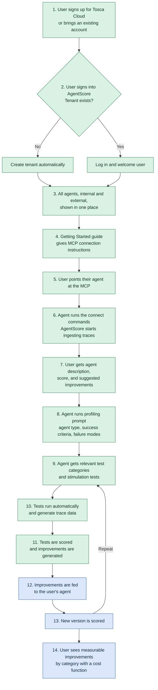

**AgentScore Roadmap - Beta Onboarding and Self-Improvement**

Date: 2026-10-14
Status: Draft (Phases 1 and 2 complete; Jira alignment and story drafts pending)

| Now | Next | Later |
|---|---|---|
| Simplify onboarding | Self-improvement loop | Trace data protection |
| Stimulation testing | App usability | AIWS integration |

**North star:** get AgentScore to as many beta users as possible. The target persona is a semi-technical user who can create agents but does not know how to configure traces, instrumentation, or agent updates. The product must prove its value, and the user must actually use it and benefit from it.

## Target user flow

Steps 1 to 7 (onboarding) and 8 to 11 (stimulation testing) are Now. Steps 12 to 14 (self-improvement loop) are Next. Step numbers match the feature notes below.

Green is Now. Blue is Next.

# Now

## Simplify onboarding

**What it is:** the path from signing up to a first actionable score, with no manual instrumentation, trace configuration, or agent changes. Flow steps 1 to 7.

**Why it matters:** the target persona can create agents but does not know how to configure traces or instrumentation. Every step of friction between sign-up and the first score loses a beta user. Self-service onboarding is also a High recurring ask from Wolters Kluwer and L'Oreal (Customer Feedback Log), and L'Oreal trialed AgentScore standalone because ingesting from an existing AI Workspace tenant needed the Workspace admin team to configure it first.

**What we hope to accomplish:** a user signs up, connects an agent, and sees a score and suggested improvements quickly, with backoffice admins no longer in the loop for tenant creation.

**North star tie:** this is the direct path to the north star. Beta reach depends on it, and the Labs Ignite to Activate bar starts with real active users, not signups.

### Features and epics

- **Tosca Cloud sign-in with login-or-create tenant** (steps 1, 2). A user signs in with a Tosca Cloud account (or brings an existing one). If no AgentScore tenant exists for them, one is created. If one exists, the user is logged in and welcomed.
- **Automatic tenant provisioning** (step 2). Tenants are created from the user's Tosca Cloud tenant, so backoffice admins no longer create tenants by hand. *(Merged with flow step 2.)*
- **Join existing tenants** (step 2). Users can join a tenant that already exists.
- **Unified agent view** (step 3). All of a user's agents, internal and external, appear in one place.
- **Getting Started guide** (step 4). An in-app guide gives the connection instructions for the MCP.
- **Zero-config agent connection via MCP** (steps 5, 6). The user points their agent at the MCP, the agent runs the commands to connect itself, and traces flow into AgentScore automatically. Non-technical users can score their first agent with no manual agent updates. *(Merged: plain-language agent setup, flow steps 5 and 6, and automatic trace sending.)*
- **First-score output** (step 7). After ingestion the user sees an agent description, a score, and suggested improvements.

## Stimulation testing

**What it is:** AgentScore profiles an agent, then runs targeted tests against it and scores the results, so users can test an agent without waiting for organic traces. Flow steps 8 to 11, which start after the first score.

**Why it matters:** scoring only organic traces leaves users without a way to test an agent before it ships. Scenario bank and simulation testing is the top High ask across Meta (x2), L'Oreal, Tritusa, Eaton, and PG&E, and is described as the pivotal gap for the Meta POC. This would also turn AgentScore into a complete, end-to-end agent testing solution, with feedback and scoring at all steps of the ADLC. Compliance validation with PII flagging (Tritusa, High) supports the compliance and PII test categories.

**What we hope to accomplish:** an agent is profiled, given the test categories that fit it, tested automatically, and scored, with improvements generated from the results.

**North star tie:** it gives beta users a reason to engage beyond the first score and answers the most common unmet ask from prospects, which is how AgentScore proves value to semi-technical users.

### Features and epics

- **Agent profiling prompt** (step 8). The user's agent runs a prompt that tells AgentScore what kind of agent it is, its success criteria, and its common failure modes.
- **Category-based stimulation test selection** (step 9). The agent is given the relevant test categories and stimulation tests that fit what it should do: compliance, security and PII, safety and harm, functional, usability, bias, robustness, multi-agent, MCP, and cost and efficiency.
- **Automated stimulation test runs** (step 10). The selected tests run automatically and generate trace data in AgentScore.
- **Stimulation scoring and improvement generation** (step 11). The test results are scored and improvements are generated. This is separate from the Now suggested improvements in first-score output, which come from organic traces.

# Next

## Self-improvement loop

**What it is:** AgentScore feeds the generated improvements back to the user's agent, re-scores the new version, and repeats, then shows what each improvement was worth. Flow steps 12 to 14.

**Why it matters:** it depends on stimulation testing producing scored results and improvements. Cost per agent (tokens, latency, estimated cost) is a High ask from L'Oreal, Tritusa, and Meta, and supports the cost function in step 14.

**What we hope to accomplish:** an agent improves across versions, and the user sees clear, measurable gains by category with a dollar or risk value attached.

**North star tie:** this is what keeps beta users coming back. It turns a one-time test into a repeatable improvement loop, which is how a user benefits from AgentScore and not just tries it.

### Features and epics

- **Improvement feedback to the agent** (step 12). The generated improvements are fed to the user's agent so it can apply them.
- **Re-score and iterate loop** (step 13). A new agent version is scored and the process repeats from test selection (step 9).
- **Measurable improvements with cost function** (step 14). The user sees improvements by category, each with a cost impact, for example "saves $X in token spend" or "avoided a GDPR violation here."

## App usability

**What it is:** product polish that makes AgentScore legible to non-technical users while they wait and when they read results.

**Why it matters:** the Now persona is non-technical. Long-running actions with no feedback and technical dimension and eval names make results hard to trust or act on. These items do not block the first score, so they follow the Now work.

**What we hope to accomplish:** users always see that an action is progressing, and understand every dimension and eval in plain language.

**North star tie:** supports adoption and retention for the target persona once they are onboarded.

### Features and epics

- **Progress bars for all actions.** Every long-running action shows progress.
- **Plain-language descriptions of dimensions and evals.** Every dimension and eval gets a non-technical explanation.

# Later

## Trace data protection

**What it is:** keeping sensitive information out of stored traces.

**Why it matters:** Tritusa raised compliance and PII flagging on traces as a High blocker for regulated (bank and pharma) clients. Wolters Kluwer raised data handling concerns in a governance-driven context, and Eaton asked for a written answer on data handling.

**What we hope to accomplish:** regulated users can send traces without exposing PII or other sensitive data.

**North star tie:** widens the set of users who can adopt AgentScore. None of the asks was a blocker for the first beta cohort, so this is Later. **Dispute risk:** if regulated beta accounts need this before onboarding, it moves up.

### Features and epics

- **PII and sensitive-data redaction from traces.** Sensitive information is redacted from traces. Treated as separate from AIWS integration.

## AIWS integration

**What it is:** integration with the AI Workspace. Placeholder, scope to be defined.

**Why it matters:** L'Oreal already has AI Workspace and 1M+ agent credits, but could not ingest into AgentScore without the Workspace admin team configuring it first. That is real demand, but the scope is undefined.

**What we hope to accomplish:** to be added.

**North star tie:** to be added.

### Features and epics

- **AIWS integration.** Placeholder. Scope, owner, and requirements to be added.

# Changes since last roadmap

None. This is the first roadmap entry.

# Open questions

1. **Boundary between "suggested improvements" in Now and "improvement generation" in Next.** Step 7 (Now) gives suggested improvements from organic traces. Step 11 (Next) generates improvements from stimulation test results. Confirm these are two different features, and that the Now version works from organic traces only.
2. **Where step 11 and step 14 land.** Stimulation testing (Now) ends at scoring and improvement generation (step 11). The self-improvement loop (Next) starts at feeding improvements back (step 12) and includes the cost function (step 14). Confirm the cost function belongs in Next, and that improvement generation belongs in Now.
3. **AIWS integration scope.** Placeholder only. Add detail when available.
4. **PII redaction timing.** Kept as Later per your list. Reconsider if any beta account is regulated.

# Jira alignment

*Pending (Phase 3).*

# Draft epics and stories

*Pending (Phase 4).*
