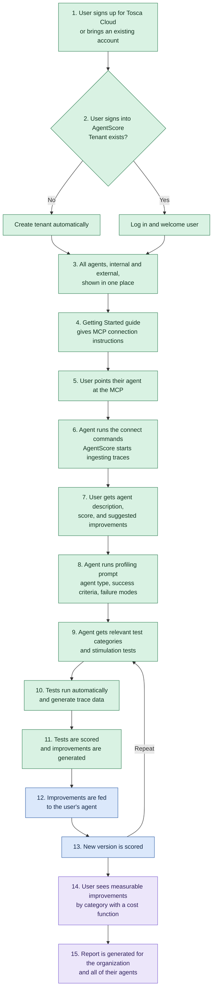

**AgentScore Roadmap - Beta Onboarding and Self-Improvement**

Date: 10-20-2026. Status: draft.

| Now | Next | Later |
|---|---|---|
| Simplify onboarding | Self-improvement loop | Trace data protection |
| Stimulation testing | Dynamic scoring | AIWS integration |
| | App usability | Quantitative cost function |
| | | Tenant-wide agent reporting |

**Target persona:** The target persona is a semi-technical user who can create agents but does not know how to configure traces, instrumentation, or agent updates. This user is creating agents or evaluating agents and makes the final call before an agent is shipped to production.

**North star:** get AgentScore to as many beta users as possible.  The product must prove its value, and users must actually use it and benefit from it. Users should be able to onboard, score, and improve their agents as simply and quickly as possible.

## Target user flow

Steps 1 to 7 (onboarding) and 8 to 11 (stimulation testing) are Now. Steps 12 and 13 (self-improvement loop) are Next. Steps 14 and 15 (measurable gains and reporting) are Later. Dynamic scoring is Next and is not a numbered step in this flow. Step numbers match the feature notes below.

Green is Now. Blue is Next. Purple is Later.

# Now

## Simplify onboarding

**What it is:** the path from signing up to a first actionable score, with no manual instrumentation, trace configuration, or agent changes. Flow steps 1 to 7.

**Why it matters:** the target persona can create agents but does not know how to configure traces or instrumentation. Every step of friction between sign-up and the first score loses a beta user. Self-service onboarding is also a High recurring ask from Wolters Kluwer and L'Oreal.

**What we hope to accomplish:** a user signs up, connects an agent, and sees a score and suggested improvements quickly, with backoffice admins no longer in the loop for tenant creation.

**North star tie:** this is the direct path to the north star. Beta reach depends on it, and the Labs Ignite to Activate bar starts with real active users, not signups.

### Features and epics

- **Tosca Cloud sign-in with login-or-create tenant** (steps 1, 2). A user signs in with a Tosca Cloud account (or brings an existing one). If no AgentScore tenant exists for them, one is created. If one exists, the user is logged in and welcomed.
  - Jira: epic [AI-15137](https://tricentis.atlassian.net/browse/AI-15137) (To Do); stories [AI-15270](https://tricentis.atlassian.net/browse/AI-15270) (Ready to Deploy), [AI-15139](https://tricentis.atlassian.net/browse/AI-15139) (To Do); prior SSO epic [AI-12369](https://tricentis.atlassian.net/browse/AI-12369) (✅ **Done**).
- **Automatic tenant provisioning** (step 2). Tenants are created from the user's Tosca Cloud tenant, so backoffice admins no longer create tenants by hand. *(Merged with flow step 2.)*
  - Jira: epic [AI-15137](https://tricentis.atlassian.net/browse/AI-15137) (To Do); stories [AI-15138](https://tricentis.atlassian.net/browse/AI-15138) (To Do), [AI-15139](https://tricentis.atlassian.net/browse/AI-15139) (To Do), [AI-15142](https://tricentis.atlassian.net/browse/AI-15142) (Backlog), [AI-15143](https://tricentis.atlassian.net/browse/AI-15143) (To Do).
- **Join existing tenants** (step 2). Users can join a tenant that already exists.
  - Jira: [AI-15140](https://tricentis.atlassian.net/browse/AI-15140) (To Do) under epic [AI-15137](https://tricentis.atlassian.net/browse/AI-15137).
- **Unified agent view** (step 3). All of a user's agents, internal and external, appear in one place.
  - Jira: none found.
- **Getting Started guide** (step 4). An in-app guide gives the connection instructions for the MCP.
  - Jira: partial. [AI-15163](https://tricentis.atlassian.net/browse/AI-15163) (To Do) (client capability matrix and one-page user guide) reads as a document, not an in-app guide. [AI-11888](https://tricentis.atlassian.net/browse/AI-11888) (✅ **Done**) was the internal onboarding guide.
- **Zero-config agent connection via MCP** (steps 5, 6). The user points their agent at the MCP, the agent runs the commands to connect itself, and traces flow into AgentScore automatically. Non-technical users can score their first agent with no manual agent updates. *(Merged: plain-language agent setup, flow steps 5 and 6, and automatic trace sending.)*
  - Jira: epics [AI-15146](https://tricentis.atlassian.net/browse/AI-15146) (To Do) (hosted MCP server, stories AI-15151 to AI-15157), [AI-15147](https://tricentis.atlassian.net/browse/AI-15147) (To Do) (plain-language agent setup, stories AI-15158 to AI-15164), [AI-15150](https://tricentis.atlassian.net/browse/AI-15150) (Backlog) (status and error handling, [AI-15176](https://tricentis.atlassian.net/browse/AI-15176), [AI-15177](https://tricentis.atlassian.net/browse/AI-15177)). Likely superseded: [AI-11886](https://tricentis.atlassian.net/browse/AI-11886) (Backlog) (skill-based agent setup).
- **First-score output** (step 7). After ingestion the user sees an agent description, a score, and suggested improvements.
  - Jira: epic [AI-15148](https://tricentis.atlassian.net/browse/AI-15148) (To Do) (scoring suggestions, stories AI-15165 to AI-15170).

## Stimulation testing

**What it is:** AgentScore profiles an agent, then runs targeted tests against it and scores the results, so users can test an agent without waiting for organic traces. Flow steps 8 to 11, which start after the first score.

**Why it matters:** scoring only organic traces leaves users without a way to test an agent before it ships. Scenario bank and simulation testing is the top High ask across Meta (x2), L'Oreal, Tritusa, Eaton, and PG&E, and is described as the pivotal gap for the Meta POC. This would also turn AgentScore into a complete, end-to-end agent testing solution, with feedback and scoring at all steps of the ADLC. Compliance validation with PII flagging (Tritusa, High) supports the compliance and PII test categories.

**What we hope to accomplish:** an agent is profiled, given the test categories that fit it, tested automatically, and scored, with improvements generated from the results. No more waiting on organic traces for scoring.

**North star tie:** it gives beta users a reason to engage beyond the first score and answers the most common unmet ask from prospects, which is how AgentScore proves value to semi-technical users.

### Features and epics

- **Agent profiling prompt** (step 8). The user's agent runs a prompt that tells AgentScore what kind of agent it is, its success criteria, and its common failure modes.
  - Jira: none open. Related: [AI-11885](https://tricentis.atlassian.net/browse/AI-11885) (Backlog) (conversational eval/profile building) and closed [AI-12231](https://tricentis.atlassian.net/browse/AI-12231) (Won't Do) (Discovery and Owner Interview).
- **Category-based stimulation test selection** (step 9). The agent is given the relevant test categories and stimulation tests that fit what it should do: compliance, security and PII, safety and harm, functional, usability, bias, robustness, multi-agent, MCP, and cost and efficiency.
  - Jira: none found.
- **Automated stimulation test runs** (step 10). The selected tests run automatically and generate trace data in AgentScore.
  - Jira: none found.
- **Stimulation scoring and improvement generation** (step 11). The test results are scored and improvements are generated. This is separate from the Now suggested improvements in first-score output, which come from organic traces.
  - Jira: none found. Related, closed: [AI-12232](https://tricentis.atlassian.net/browse/AI-12232) (Won't Do) (Dynamic Scoring - Scorecard and Trust).

# Next

## Self-improvement loop

**What it is:** AgentScore feeds the generated improvements back to the user's agent, re-scores the new version, and repeats. Flow steps 12 and 13. Showing what each improvement was worth and reporting across the organization (steps 14 and 15) are Later.

**Why it matters:** Creating fast loops for semi-technical users where an agent is evaluated, improvements are suggested and applied, and then retesting that agent is how AgentScore wins. Nailing this loop is the single biggest source of value we can give to users. 

**What we hope to accomplish:** an agent improves across versions as improvements are fed back and the new version is re-scored.

**North star tie:** this is what keeps beta users coming back. It turns a one-time test into a repeatable improvement loop, which is how a user benefits from AgentScore and not just tries it.

### Features and epics

- **Improvement feedback to the agent** (step 12). The generated improvements are fed to the user's agent so it can apply them.
  - Jira: epic [AI-15149](https://tricentis.atlassian.net/browse/AI-15149) (To Do) (self-update loop, stories AI-15171 to AI-15175: playbook, guardrails, audit, anomaly flagging).
- **Re-score and iterate loop** (step 13). A new agent version is scored and the process repeats from test selection (step 9).
  - Jira: none found.

## Dynamic scoring

**What it is:** a scorecard written for each agent, plus session grouping so a score covers a whole task or conversation. Fixed profiles stay available during beta, and dynamic scoring runs beside them. The scorecard can be drafted in three ways: a conversation with the agent owner, inference from the agent's traces and behavior, or dimensions and weights the user sets directly.

**Why it matters:** a fixed profile catalog force-fits agents that do not match it, and a score on one trace misses a multi-step task. The August 24 working session called dynamic scoring profiles and session-based scoring the two highest-priority product gaps. Eaton reacted to editable success criteria, profiles, and weighted dimensions ("exactly what I was looking for"). New Vision accepted editable success criteria and custom dimensions. **Dispute risk:** that August session ranked this above other product work, so it could be argued into Now. It stays Next so the first score and stimulation testing are not blocked on a new scoring model.

**What we hope to accomplish:** a user can score an agent on criteria that fit that agent, across a whole session, without giving up the fixed profiles already in the product.

**North star tie:** beta users get a score that matches their own agent, which is what makes the improvement loop worth repeating. It follows onboarding so more users can reach a first score on the model that already ships.

### Features and epics

- **Per-agent scorecard.** A scorecard written for one agent. It can come from a conversation with the owner, from the agent's traces and behavior, or from dimensions and weights the user sets. During beta this runs beside the fixed profile catalog.
- **Session grouping.** Related traces are grouped into a task or conversation, and the score covers that whole session.

## App usability

**What it is:** product polish that makes AgentScore legible to non-technical users while they wait and when they read results.

**Why it matters:** the Now persona is non-technical. Long-running actions with no feedback and technical dimension and eval names make results hard to trust or act on. These items do not block the first score, so they follow the Now work.

**What we hope to accomplish:** users always see that an action is progressing, and understand every dimension and eval in plain language.

**North star tie:** supports adoption and retention for the target persona once they are onboarded.

### Features and epics

- **Progress bars for all actions.** Every long-running action shows progress.
  - Jira: under epic [AI-10597](https://tricentis.atlassian.net/browse/AI-10597) (AgentScore Improvements): [AI-15178](https://tricentis.atlassian.net/browse/AI-15178) (To Do) (shared component), [AI-15179](https://tricentis.atlassian.net/browse/AI-15179) (To Do) (ingestion), [AI-15180](https://tricentis.atlassian.net/browse/AI-15180) (To Do) (scorecard building), [AI-15181](https://tricentis.atlassian.net/browse/AI-15181) (To Do) (scoring run).
- **Plain-language descriptions of dimensions and evals.** Every dimension and eval gets a non-technical explanation.
  - Jira: [AI-15268](https://tricentis.atlassian.net/browse/AI-15268) (To Do) under epic [AI-10597](https://tricentis.atlassian.net/browse/AI-10597); prior story [AI-11884](https://tricentis.atlassian.net/browse/AI-11884) (✅ **Done**) (plain-language evaluations in scoring UI).

# Later

## Trace data protection

**What it is:** keeping sensitive information out of stored traces.

**Why it matters:** Tritusa raised compliance and PII flagging on traces as a High blocker for regulated (bank and pharma) clients. Wolters Kluwer raised data handling concerns in a governance-driven context, and Eaton asked for a written answer on data handling.

**What we hope to accomplish:** regulated users can send traces without exposing PII or other sensitive data.

**North star tie:** widens the set of users who can adopt AgentScore. None of the asks was a blocker for the first beta cohort, so this is Later. **Dispute risk:** if regulated beta accounts need this before onboarding, it moves up.

### Features and epics

- **PII and sensitive-data redaction from traces.** Sensitive information is redacted from traces. Treated as separate from AIWS integration.
  - Jira: [AI-11914](https://tricentis.atlassian.net/browse/AI-11914) (To Do) under epic [AI-11882](https://tricentis.atlassian.net/browse/AI-11882) (In Progress) (Beta Legal and Compliance).

## AIWS integration

**What it is:** show AgentScore results on agents inside AI Workspace, so a user sees how an agent scores without leaving AIWS. The score and ship decision come from the AgentScore score endpoint: `/v1/tenants/{slug}/agents/{name}/score`.

**Why it matters:** L'Oreal already has AI Workspace and 1M+ agent credits but could not ingest into AgentScore without the Workspace admin team configuring it first. AI Workspace is the easiest surface for reaching AgentScore (AI-11881), and showing the score in place is the visible payoff.

**What we hope to accomplish:** once an AIWS agent is scored, its score and ship decision appear next to it, the user is told when new evidence makes a rescore worthwhile, and later can see scoring status and score movement.

**North star tie:** a built-in route to users who already have AI Workspace. The score shows in the tool they already use, which makes the value of AgentScore visible with no extra steps. It stays in Later because it is marked optional for beta (per AI-11881's source page) and the owner of the AI Workspace UI has not yet been engaged.

### Features and epics

- **Score and ship decision next to the AIWS agent.** Once an AIWS agent is scored, show its score and `ship_decision`, read from `/v1/tenants/{slug}/agents/{name}/score`. Jira: Confirm AI-11912 includes the ship decision.
  - Jira: [AI-11912](https://tricentis.atlassian.net/browse/AI-11912) (Backlog) under epic [AI-11881](https://tricentis.atlassian.net/browse/AI-11881) (In Progress).
- **"New evidence available. Rescore?" prompt.** A link or button that appears when new traces have arrived since the last score. Open question: a minimum number of new traces before it shows, so a single extra trace does not trigger a rescore.
  - Jira: none found.
- **Later: scoring status.** Show whether a score is running. Open question: can this be done when all AgentScore endpoints are GETs?
  - Jira: none found.
- **Later: score change indicator.** An arrow showing how the score moved since the last run.
  - Jira: none found.

**Existing AI-11881 stories not in this list:** AI-12669 (ingest EUS3 production traces so workspace-created agents appear in AgentScore), AI-12670 (AgentScore as a built-in AIWS agent type with visible trace routing), AI-11911 (choose agents and workflows to score from AIWS), AI-11910 (improve onboarding for AIWS agents). Decide whether to keep them in the theme, or defer or drop them. AI-15142 (reconcile AIWS auto-created tenants) is already counted under Simplify onboarding.

## Quantitative cost function

**What it is:** the user sees measurable improvements by category, each with a cost impact, backed by a quantitative model that puts a measured dollar or risk value on each improvement. Flow step 14.

**Why it matters:** showing impact such as "saves $X in token spend" proves the value of each improvement. A quantitative model makes those numbers defensible for the person who makes the final ship call.

**What we hope to accomplish:** every improvement carries a calculated cost or risk value the user can trust and compare.

**North star tie:** shows beta users the benefit of AgentScore in numbers, which supports the proof-of-value half of the north star.

### Features and epics

- **Measurable improvements by category** (step 14). The user sees improvements by category, each with a cost impact, for example "saves $X in token spend" or "avoided a GDPR violation here."
  - Jira: none found. [AI-11896](https://tricentis.atlassian.net/browse/AI-11896) (In Progress) tracks credits per scoring run, which is Tricentis billing, not the user-facing value.
- **Quantitative cost function for improvements.** Each generated improvement is valued with a quantitative cost model, for example token spend saved or risk exposure avoided.
  - Jira: not yet checked.

## Tenant-wide agent reporting

**What it is:** generate a report for the organization covering all agents in a tenant. Flow step 15.

**Why it matters:** the person who decides what ships needs one view across every agent, not one report per agent.

**What we hope to accomplish:** a user generates a single report for all agents in their tenant.

**North star tie:** gives decision makers a reason to keep using AgentScore after the first agent is scored.

### Features and epics

- **Report generation for all agents in a tenant** (step 15). One report covering every agent in the tenant.
  - Jira: not yet checked.

# Changes since last roadmap

Compared with [2026-10-14-agentscore-beta-roadmap.md](2026-10-14-agentscore-beta-roadmap.md).

- **Added:** Dynamic scoring, under Next. Two features: a per-agent scorecard (owner conversation, inferred from traces, or user-set dimensions and weights) and session grouping. Fixed profiles stay during beta.
- **Moved:** none.
- **Dropped:** none.

# Open questions

- Does stimulation testing (steps 8 to 11) score against the dynamic scorecard, or does it keep today's scoring?

